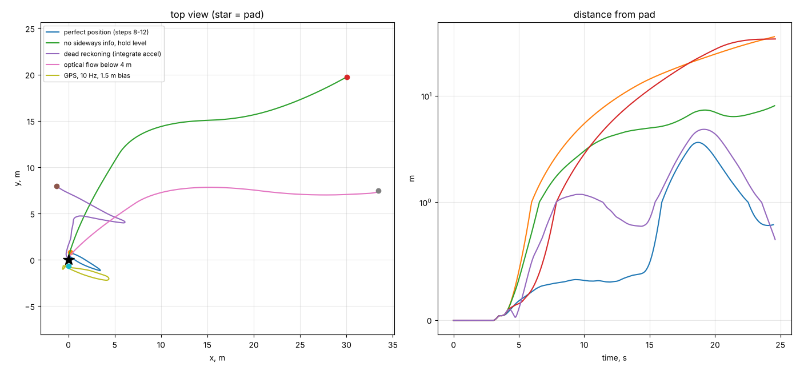
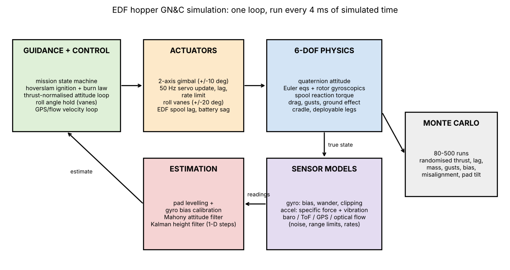

# EDF Hopper GN&C

Guidance, navigation and control for a thrust-vectored electric ducted fan (EDF) hopper that takes off, climbs to ~30 m, cuts to idle, falls, and lands itself with a hoverslam burn.

This repo is the simulation side of the project. The hardware (printed 2-axis gimbal, roll vanes, ESP32 flight computer) is being built and tested in parallel.



## Headline results (simulation)

| Question | Result |
|---|---|
| Does a hoverslam survive realistic errors? | Naive guidance: **6%** soft landings over 500 runs. With accelerometer integral feedback, a terminal gate and planning margin: **100%**. |
| Can attitude control work across the whole thrust range? | Fixed gains: **8%** success. Thrust-normalised control: **100%** over 300 runs. |
| What happens if the controller ignores body roll? | It flips **95%** of the time. Rotating the error into the body frame fixes it. |
| Can the accelerometer be trusted in flight? | No. Trusting it all flight: **42%**. Level on the pad, calibrate gyro bias, then gyro-only in flight: **99%**. |
| Is GPS needed? | Without it the craft lands softly but up to **~45 m** away. GPS + optical flow + a "kill sideways speed" terminal phase: **99%** soft landings within **~9 m** (95th percentile). |

## What the simulation models



- 6-DOF rigid body with quaternion attitude, Euler's equations and fan rotor gyroscopics
- EDF spool lag, battery voltage sag, spool-up reaction torque on the roll axis
- 2-axis gimbal and roll vanes as real servos: 50 Hz updates, lag, rate limits, travel limits
- Sensors: gyro bias and bias wander, gyro clipping, accelerometer specific force plus EDF vibration, barometer, ToF, GPS bias, optical flow range limits
- Full mission state machine: pad, spool-up, cradle liftoff, climb, go/no-go, idle coast, fall, ignition plus leg deployment, braking burn, terminal descent, touchdown
- Monte Carlo over thrust error, spool lag, mass, gusts, sensor bias, thrust misalignment and pad tilt

## Run it

```bash
pip install -r requirements.txt
python sim/hopper_sim.py
```

Prints the five-way navigation comparison and the Monte Carlo table (about 2 to 3 minutes), then plots the detailed flight.

## How it was built

The sim grew one effect at a time, from a 1-D altitude loop to full 6-DOF. Each step, its code, its result and what it taught me is in [`devlog/`](devlog/DEVLOG.md). Some steps are dead ends on purpose: step 9 tested a tilt cap that made landings worse and was dropped.

## Limitations

- **Every vehicle parameter is an estimate.** Thrust curve, spool lag, inertias, vane authority and servo dynamics come from datasheets and CAD, not measurements yet.
- Aerodynamics are simple drag terms. Wind is a constant force during the fall.
- Not modelled yet: gimbal backlash, leg-deploy failures, ESC or power faults, sensor dropouts beyond range limits.

A high success rate here means the design is not the weak link. It does not mean the real vehicle will land.

## Roadmap

1. Bench tests: thrust stand, spool lag, roll torque kick, gimbal step response
2. System identification: replace the estimates with measured values and re-run everything
3. Software-in-the-loop: run the actual ESP32 flight code against this sim
4. Hardware-in-the-loop: ESP32 on the bench, talking to the sim over USB
5. Flight test ladder: hops, low drops, full 30 m hoverslam

## Author

Hananeel Mandam, Mechanical Engineering, BITS Pilani Hyderabad
