# Devlog

The simulation, one step at a time. Each step adds one effect, tests it, and keeps what worked. Code for each step is frozen in this folder so every result can be reproduced.

### Step 1: vertical PD + gravity feed-forward (`sim1d.py`)
Climb to 10 m, hover, descend. The craft lags its target the whole way and lands slowly. Lesson: a position-only controller always trails a moving target.
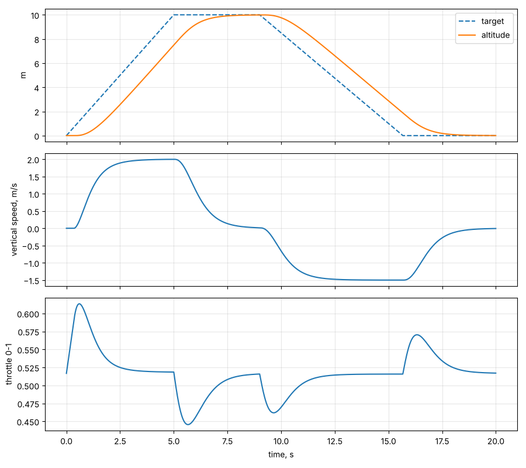

### Step 2: velocity feed-forward (`sim1d_step2.py`)
Tracking is now tight, but it still hits the ground at 1.5 m/s because the descent profile never slows down.
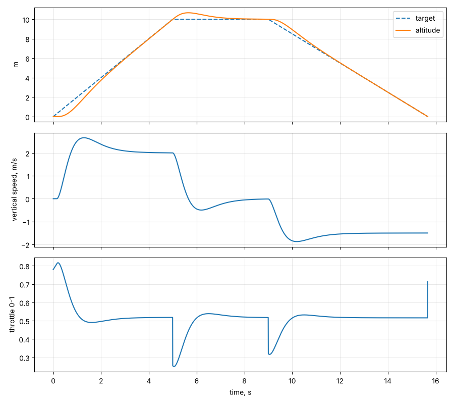

### Step 3: first hoverslam from 30 m (`sim1d_step3.py`)
Ignite when stopping distance plus spool-up distance reaches the ground, then re-plan the braking every step. Ignition at 17.9 m and 13.1 m/s, touchdown at 0.14 m/s. Perfect, because nothing is wrong yet.
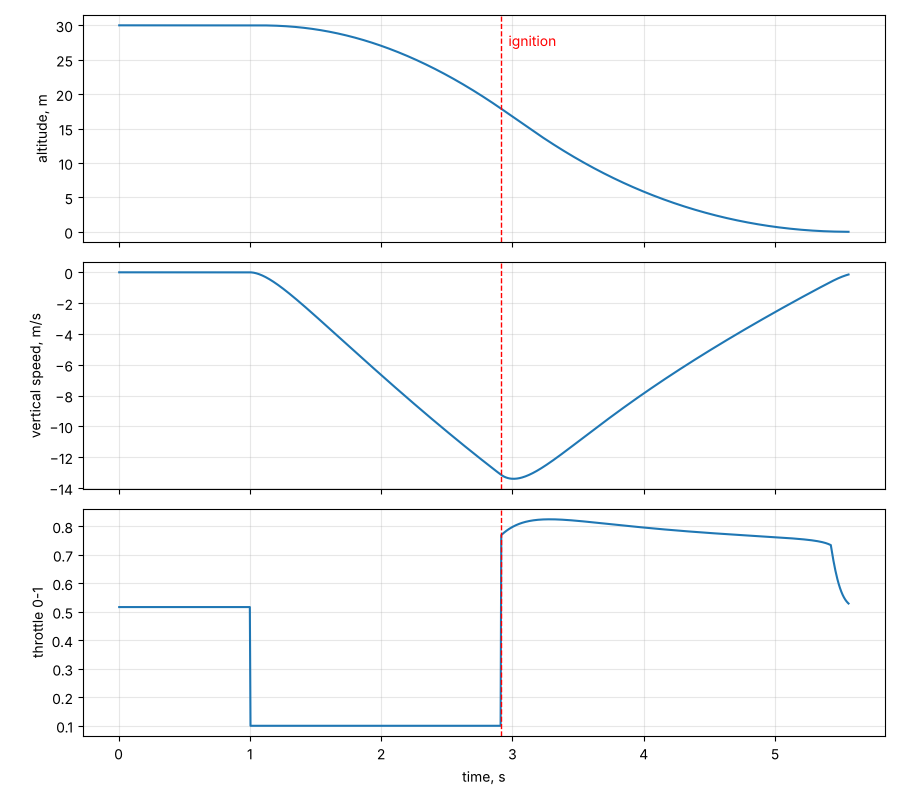

### Step 4: Monte Carlo, 500 runs (`sim1d_step4.py`)
Thrust 80 to 105% of claimed, spool lag 0.1 to 0.3 s, mass +/-, altitude sensor bias. Only **6%** soft. 25% hard, 53% crash, 17% stopped in the air. The perfect step 3 was an illusion.
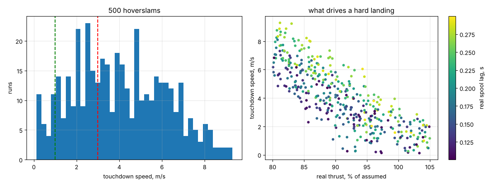

### Step 5: three fixes (`sim1d_step5.py`)
Integral feedback on measured acceleration (with anti-windup), a gate at 1.5 m then a slow terminal descent, and planning the burn with only 70% of assumed thrust. **100%** soft, worst 0.59 m/s.
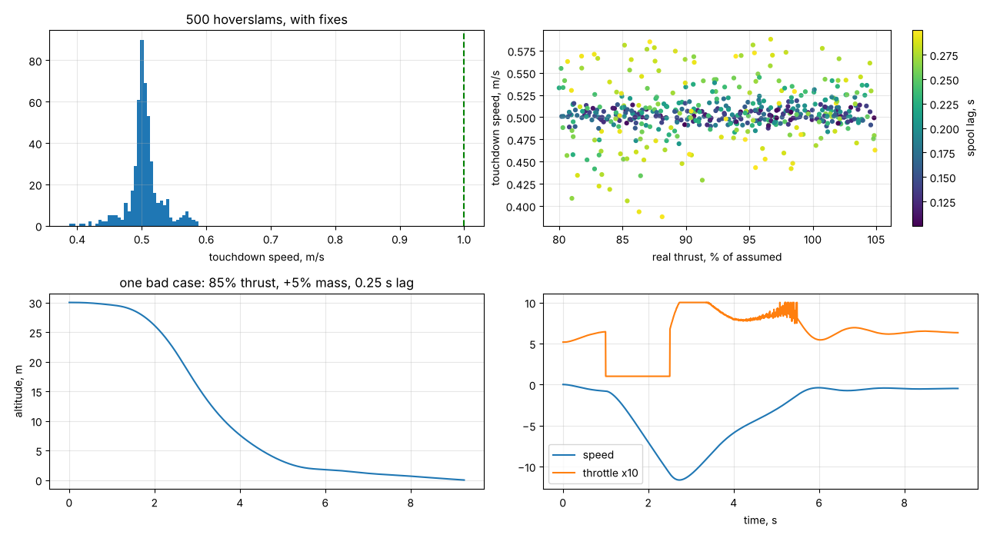

### Step 6: Kalman filter instead of true state (`sim1d_step6.py`)
State [height, speed, accel bias] from accelerometer, barometer and ToF. Still 100% soft, but a constant 0.45 m height error from barometer bias, and a speed kick when the ToF takes over below 4 m. Lesson: a filter cannot see a bias it has no way to observe.
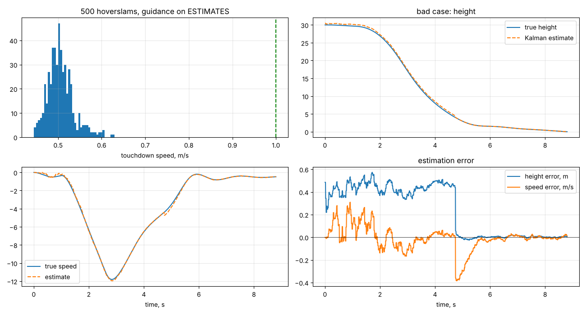

### Step 7: pad calibration + baro offset state (`sim1d_step7.py`)
Zero the barometer on the pad and let the filter estimate the remaining offset. 100% soft, worst 0.64 m/s, height error under 0.25 m, no handover kick.
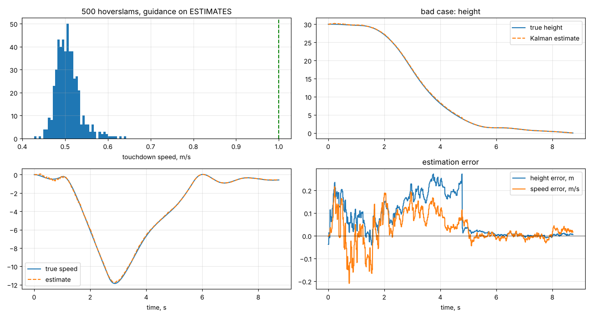

### Step 8: 2-D, the craft can tilt (`sim2d_step8.py`)
Pitch dynamics, gimbal servo lag and rate limit, side gusts. Fixed attitude gains: **8%** success, because gimbal authority scales with thrust. Thrust-normalised control (pick the angular acceleration, then compute the gimbal angle for the current thrust): **100%** over 300 runs, worst miss 1.09 m.
Note: steps 8 to 12 give the controller a perfect position sensor. Step 13 removes that.
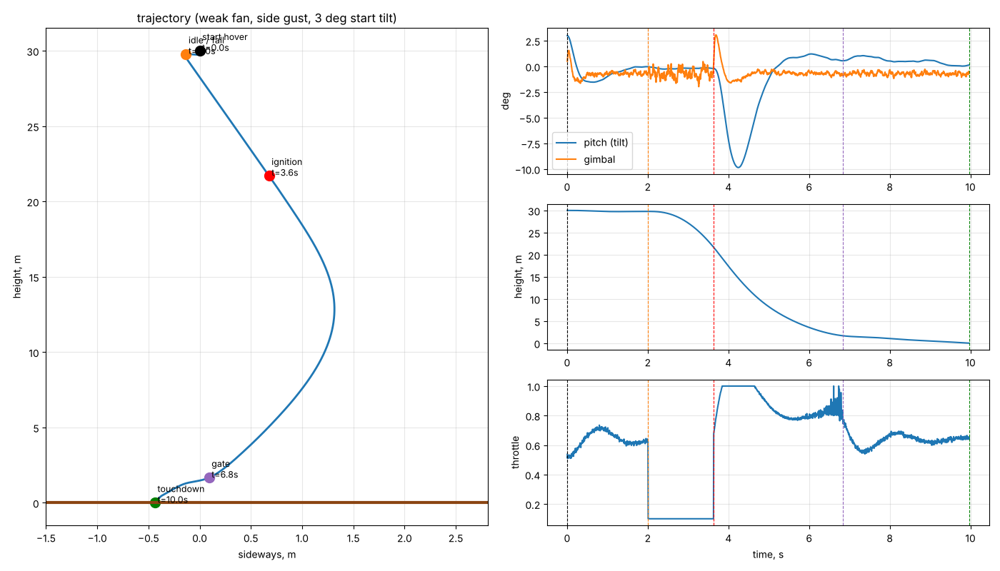

### Step 9: tilt cap during the burn (`sim2d_step9.py`), rejected
Idea: cap tilt at 2 degrees during braking so the burn stays vertical. Result: misses got worse and nothing got safer. Dropped.
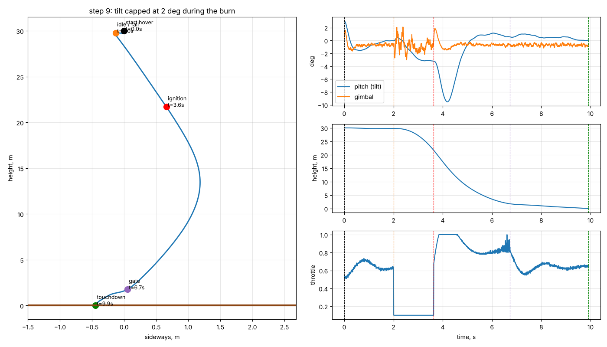

### Step 10: full mission + roll channel (`sim2d_step10.py`)
Cradle liftoff, ground effect, go/no-go at 30 m, idle coast, leg deploy at ignition, battery sag. Roll: fan swirl, spool-up reaction torque, vane damping. Idle at 10% gives a median roll rate of 488 deg/s after ignition. Idle at 40% cuts it to 163 deg/s. A shaped ignition ramp barely helps. Battery use is only about 18% of the pack.
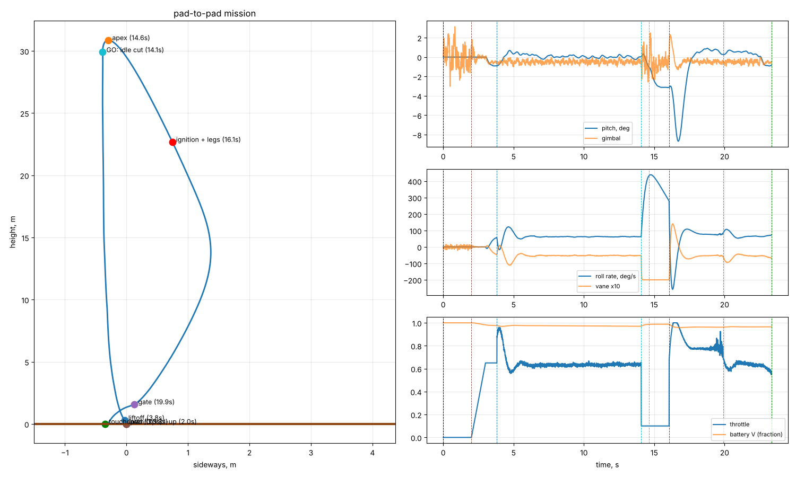

### Step 11: full 6-DOF (`sim6dof_step11.py`)
Quaternions, gimbal in the body frame, rotor gyroscopics, 50 Hz servo updates. A controller that ignores roll flips **95%** of the time. Rotating the error into the body frame: 100%. Rotor gyroscopics turned out negligible. A proportional-only roll damper leaves a steady ~60 deg/s spin.
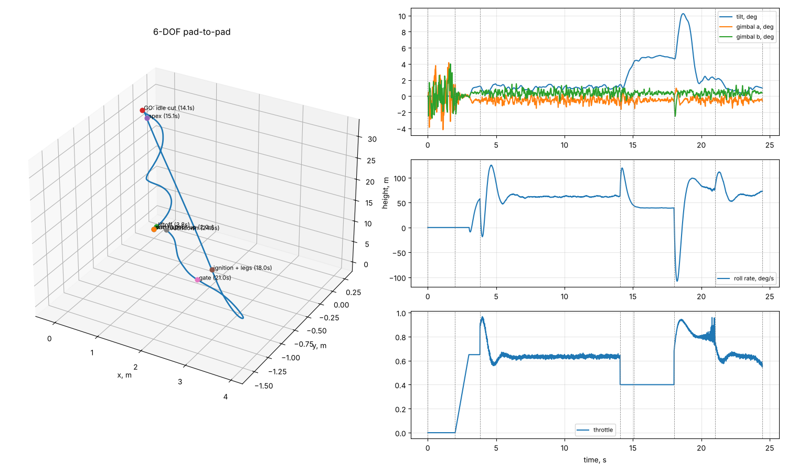

### Step 12: real attitude estimate (`sim6dof_step12.py`)
Simulated MPU6050, Mahony filter, roll angle hold with integral action, tilted cradle, gyro bias up to 3 deg/s.

| Estimator | Soft and upright |
|---|---|
| Trust the accelerometer all flight | 42% |
| Level on pad, no gyro bias calibration | 1% |
| Level on pad + gyro bias calibration | **99%** |

Lesson: in powered flight the accelerometer measures thrust, not gravity, so it cannot tell you tilt. Roll hold cut the steady spin from 57 to 1 deg/s.
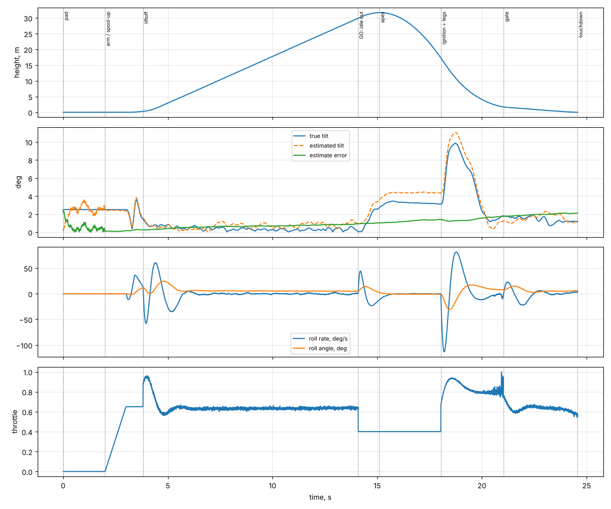

### Step 13: no-GPS reality check (`sim6dof_step13.py`)
Removed the perfect position sensor. Success now also requires sideways speed under 0.5 m/s at touchdown.

| Navigation | Success | 95% miss |
|---|---|---|
| Perfect position (steps 8 to 12) | 81% | 4.1 m |
| None, hold level | 1% | 63.6 m |
| Dead reckoning | 2% | 58.1 m |
| Optical flow below 4 m | 99% | 43.9 m |
| GPS + terminal speed kill | 96% | 9.6 m |
| **GPS + flow + terminal speed kill** | **99%** | **8.8 m** |

Found a bug carried since step 8: below 0.3 m the controller forced "level", but level by a drifted estimate is really 2 to 3 degrees of lean, so the craft slid at touchdown. Fix: hold the last tilt the velocity loop found. Lesson: when a sensor goes blind near the ground, hold the last command.
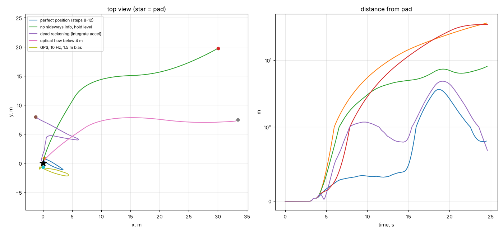
